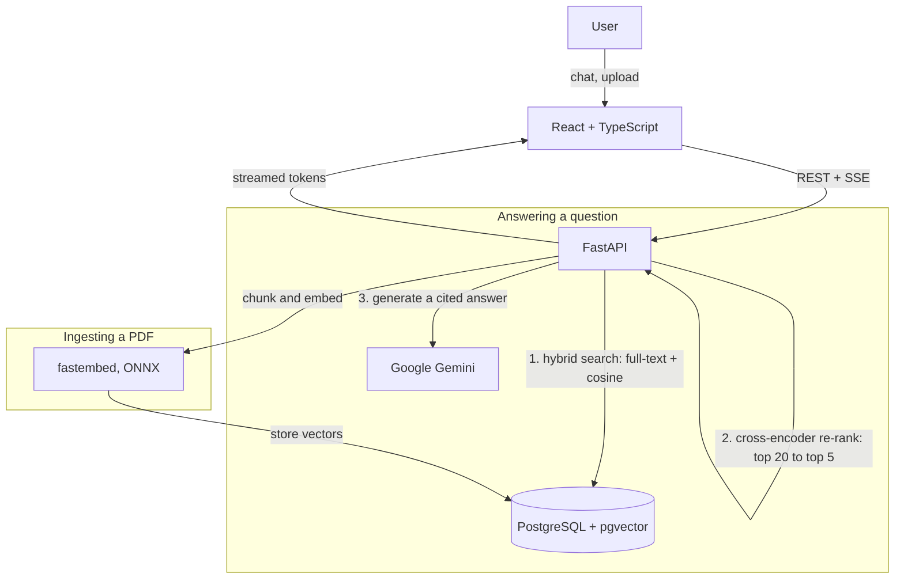

# MedRAG Assistant

Ask questions about medical PDFs (clinical guidelines, studies, drug references) and get answers that cite the exact source and page. Retrieval is hybrid search with cross-encoder re-ranking, and Google Gemini writes the answer.

**[Frontend repo](https://github.com/mahalingam-dev-8/medrag-frontend)**

### Try asking

- *What are the common symptoms of an asthma attack, and what should a patient do first?*
- *How can you tell heart failure from an asthma attack based on symptoms, and when is emergency care needed?*
- *What is the recommended treatment for a fractured wrist?* The documents don't cover this, so it should say so rather than guess.

## How it works



## Why it's built this way

**Hybrid search, because medical terms break pure semantic search.** Abbreviations and drug names like "eGFR", "SGLT2" or "A1C" have no close neighbours in embedding space, so semantic search alone misses them. Postgres full-text search catches the exact terms, semantic search catches paraphrases, and Reciprocal Rank Fusion merges the two lists without having to normalise their scores.

**A cross-encoder for the final ranking.** Cosine similarity compares the question and each chunk separately, which is fast but approximate. A cross-encoder reads them together and scores them much more accurately, but it's too slow to run on everything. So the app retrieves 20 candidates cheaply and re-ranks only those down to the 5 that go to the LLM.

**pgvector instead of a separate vector database.** Documents, vectors and chat history all live in one Postgres database: one connection, one transaction boundary, one backup. At this scale, Pinecone or Weaviate would add moving parts without a measurable gain.

**ONNX embeddings to fit a 512 MB server.** fastembed runs the embedding model on ONNX Runtime instead of PyTorch, so the whole API fits within that limit with no model download at startup.

## Evaluation

I wrote 15 question-and-answer pairs across three topics (diabetes guidelines, heart failure, and NNDS survey data) and scored the system with RAGAS, using `gpt-4o-mini` as the judge.

| Metric | Score | What it measures |
|---|---|---|
| Context recall | **0.933** | The retrieved chunks contain what the reference answer needs |
| Context precision | **0.882** | The retrieved chunks are relevant, with little noise |
| Faithfulness | **0.862** | The answer's claims are backed by the retrieved text |
| Answer relevancy | **0.811** | The answer addresses the question |
| Answer correctness | 0.493 | Wording and facts match the reference answer |

Answer correctness is low mostly because the reference answers are short fragments and the model writes full sentences, which the metric penalises even when the facts are right. Context recall and faithfulness are the better signals of whether the system works.

Before settling on `gpt-4o-mini` as the judge, I tried a few others: local FastEmbed similarity (blind to negation and hallucination), Ollama llama3.2 (over 5 minutes per sample, plus JSON parsing errors) and Groq (hit daily token limits mid-run). `gpt-4o-mini` gave reliable JSON for under $0.005 per full run.

## Tech stack

FastAPI · PostgreSQL + pgvector · fastembed (ONNX) · ms-marco-MiniLM cross-encoder · Google Gemini · RAGAS · React + TypeScript

<details>
<summary><b>Run locally</b></summary>

```bash
git clone https://github.com/mahalingam-dev-8/medrag-backend.git
cd medrag-backend
python -m venv venv && source venv/bin/activate
pip install -e .
uvicorn app.main:app --reload
```

Run the evaluation (needs `OPENAI_API_KEY` in `.env`):

```bash
pip install ".[eval]"
python evaluation/run_eval.py --api-url http://localhost:8000
```

</details>

## What I'd add next

- A proper job queue (Celery + Redis) for ingesting PDFs, with retries and progress, instead of FastAPI's `BackgroundTasks`.
- Automated A/B runs of chunk size, top-k and search weights against the RAGAS set.
- A self-hosted model through Ollama, for deployments where documents can't leave the network.
- Indexing tables and figures from PDFs, not just text.
